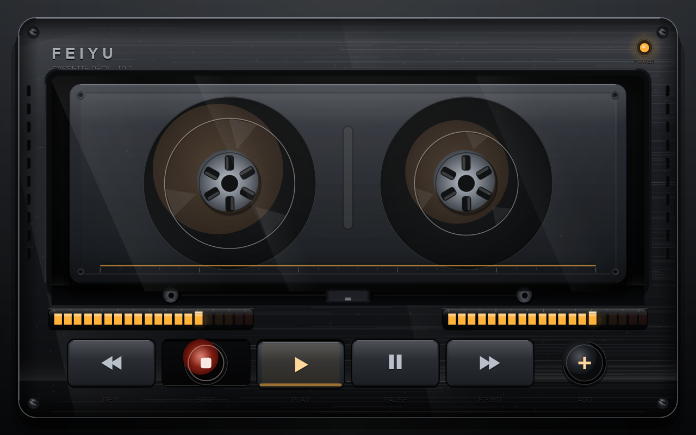
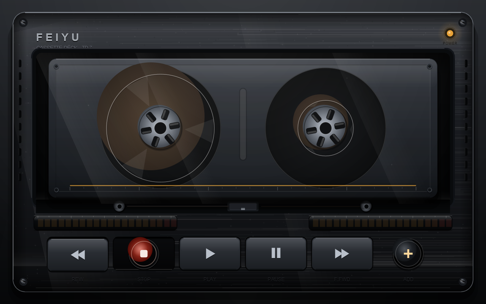
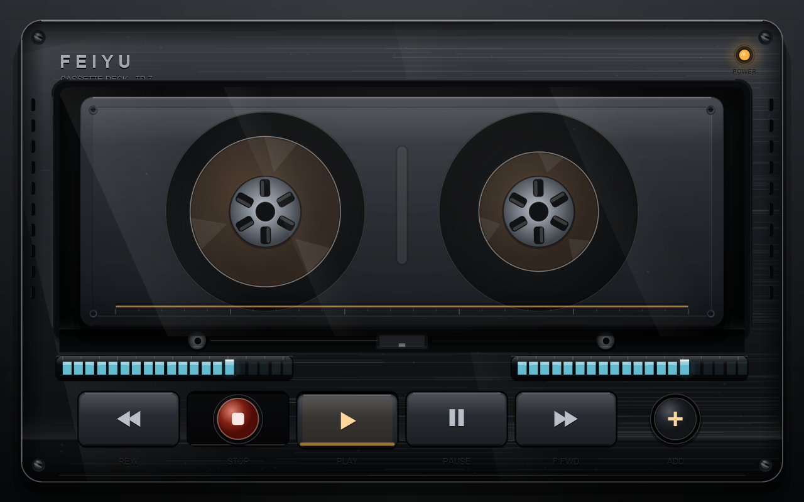

# 磁带机 · Tape Deck

把 Android 平板变成一台老式卡座播放器。

纯 Java · 无广告 · 不联网 · 安装包约 165 KB



## 它是什么

这不是一个“套了磁带皮肤的播放列表”。

每次选歌，都像从盒子里取出一盘磁带放进卡座：按下播放，卷盘开始转，电平表跟着音乐跳；快进、倒带、暂停、停止都有各自的机械声。带子放完，机器会“咔哒”一声自动停下。

界面、按键、表头、磁带盒全部是代码画的，没有贴图，也没有第三方 UI 库。

## 功能

- **三种音色**：AM（32 kHz 暖声）、HI-FI（原声）、BASS（低频增强）
- **磁带式装带**：点 ＋ 扫描本地歌曲，点选顺序就是播放顺序；点“装带”后整条替换当前磁带
- **排序**：扫描页可按标题或添加时间排序，切换排序不会打乱已点选的顺序
- **机械交互**：播放 / 暂停 / 停止 / 快进 / 倒带，长按快进或倒带可连续走带
- **带尾自动停**：一首放完自动停机，不会无限循环
- **后台播放**：前台服务，锁屏或切到后台继续走带
- **极简界面**：桌面图标里的“磁带机 · 极简”可绕开自绘台面，直接进入简单控制页
- **本地优先**：不申请网络权限，不上传歌曲，不收集统计

## 截图

| 播放 | 倒带 | 电平表 |
|---|---|---|
|  |  |  |

## 安装

1. 打开 [Releases](releases/latest)，下载 `磁带机-2.9.6.apk`
2. 在 Android 平板上允许“安装未知来源应用”
3. 安装后打开，首次点 ＋ 时授予音频/媒体读取权限
4. 选歌 → 装带 → 播放

要求 **Android 4.4（API 19）及以上**。APK 不含 `.so`，所有 ABI 通用。

## 使用

- **＋**：扫描本地音频，进入装带页
- **装带**：把点选的歌曲按顺序装进当前磁带；点选顺序就是播放顺序
- **PLAY / PAUSE**：播放或暂停
- **FF / REW**：短按跳 10 秒；长按连续快进 / 倒带，松手回到当前播放位置
- **STOP**：停止并回到带首
- **MODE**：切换 AM / HI-FI / BASS
- **排序**：在扫描页右上角切换“标题 / 添加时间”

> 装带会替换当前磁带。想保留当前播放位置，先不要点“装带”。

## 隐私与权限

- `READ_EXTERNAL_STORAGE` / `READ_MEDIA_AUDIO`：只用于扫描本地音频文件
- `FOREGROUND_SERVICE`：锁屏或切后台时继续播放
- 没有 `INTERNET` 权限；没有广告 SDK、统计 SDK 或账号系统

## 兼容性

- 主要在 **MI PAD（Android 7.1.2，2048×1536）** 上开发和实测
- `minSdk 19`，`targetSdk 28`
- 横屏平板体验最佳；手机竖屏未做专门适配

## 从源码构建

需要 JDK 8+、Android SDK（build-tools、platform android.jar）。

仓库不包含签名密钥。先准备自己的 keystore：

```bash
keytool -genkeypair -v \
  -keystore tape.jks -alias tape \
  -keyalg RSA -keysize 2048 -validity 10000
```

然后设置环境变量并构建：

```bash
export ANDROID_HOME="$HOME/Android/Sdk"   # Windows: %LOCALAPPDATA%\Android\Sdk
export TAPE_KS_PASS='你的 keystore 密码'
export TAPE_KEY_PASS='你的 key 密码'

git clone <你的仓库地址>
cd tape-android
./build.sh
```

`build.sh` 会自动查找 build-tools 和 platform；也可以用 `BUILD_TOOLS_VERSION`、`PLATFORM_VERSION`、`VERSION_CODE`、`VERSION_NAME` 覆盖。产物在 `app/build/out`，复制为 `.apk` 后即可安装。

> 不要把 `tape.jks` 或密码提交到仓库；`.gitignore` 已默认忽略 `*.jks` 和 `*.keystore`。

## 更新日志

### 2.9.6

- 修复默认 AM 档没有初始 AudioTrack 的问题
- 新音轨 / seek / 暂停恢复时先预填约 46–64 ms 真实 PCM，再开始播放，减少起播“滋”声与欠载卡顿
- 保留 2.9.4 的修复：长按松手不重复 seek、暂停清空缓冲、机械声截短、暂停时关闭一次性音轨
- 保留 2.9.3 的绘制优化与 2.9.2 的扫描页排序

完整记录见 [RELEASE_NOTES.md](RELEASE_NOTES.md)。

## License

MIT
